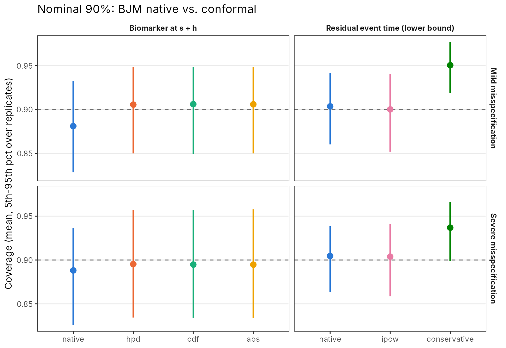
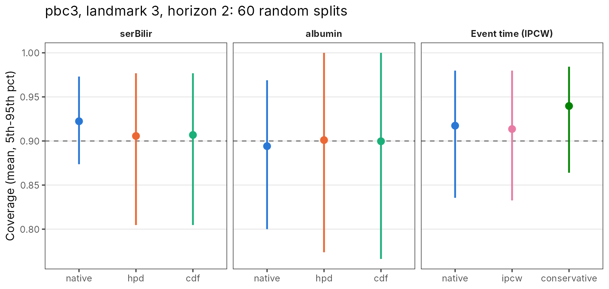

# BJMconformal：给 BJM 动态预测加上保形（conformal）保证

在 [BJM](https://github.com/wenhaoli18/BJM) 0.3.0 的两个公开预测函数外面包一层 split conformal 校准，**不改 BJM 本身**：

| 函数 | 包装的 BJM 函数 | 输出 | 保证 |
|---|---|---|---|
| `conformalLongitudinal()` | `predictLongitudinal()` | s+h 时刻生物标志物值的预测区间 | P(Y ∈ Ĉ) ≥ 1−α，有限样本、精确、分布无关 |
| `conformalEventTime()` | `predictRisk()`（多个 horizon） | 剩余事件时间的下界 L̂：P(T−s ≥ L̂ \| T>s) ≥ 1−α | `"conservative"`：有限样本精确，任何删失机制都成立；`"ipcw"`：近似，要求删失独立 |
| `vennAbersRisk()` | `predictRisk()` | 区间值风险 [p₀, p₁] 和重新校准后的 p | 无删失时 p₀、p₁ 之一完全校准；有删失时用 IPCW，近似 |

以上保证都**不要求 BJM 模型设定正确**。模型对的时候，保形区间几乎就是 BJM 自己的区间；模型错的时候，校准分位数会自动移动，把覆盖率拉回 1−α。

## 安装

```r
remotes::install_github("wenhaoli18/BJM")
remotes::install_github("wenhaoli18/BJM-conformal")
```

## 用法

数据分三份，按病人划分：拟合（fit）、校准（calib）、测试或新病人（test）。BJM 子模型只用拟合集来拟合。

```r
library(BJM); library(BJMconformal)
# sf, lf 由 survivalSub() / longitudinalSub() 在拟合集上拟合
tr <- survivalTrans(c(1, 3, 5, 7))
a  <- list(long_fit_all = lf, survival_fit_all = sf, prediction_time = 3,
           time_variable = "year",
           survival_variable_all = tr$survival_variable_all,
           survival_trans_function = tr$survival_trans_function)

# 1. 胆红素在 3+2 年的 90% 区间（HPD 分数；可同时要多个分数，预测只算一次）
bl <- do.call(conformalLongitudinal,
              c(list(bio_i = 1, data_calib = cal, data_test = tst, horizon = 2,
                     alpha = 0.1, score = c("hpd", "cdf")), a))
bl$hpd$intervals   # id, lower, upper, native_lower, native_upper, ...

# 2. 剩余无事件时间的 90% 下界（最多到 4 年）
et <- do.call(conformalEventTime,
              c(list(data_calib = cal, data_test = tst, max_horizon = 4,
                     alpha = 0.1, censoring = "conservative"), a))

# 3. (3, 5] 年风险的 Venn–Abers 区间
va <- do.call(vennAbersRisk,
              c(list(data_calib = cal, data_test = tst, horizon = 2), a))
```

## 方法

### 生物标志物（`conformalLongitudinal`）

- **校准病人**：在 landmark s 时仍无事件、s 之前至少测过一次该标志物、并且在 s+h ± `window` 内有一次测量的病人，取离 s+h 最近的那次测量 t\*。每个病人只贡献一个分数，所以分数在病人之间可交换。
- **不规则随访**：对每个校准病人单独调用 `predictLongitudinal(horizon = t* − s)`，只用 s 之前的历史。这样条件和目标一致：给定 s 之前的历史，并且在被预测的时刻还活着。
- **分数**：都由 BJM 的预测密度 `Y_density` 计算。
  - `"hpd"`（默认，HPD-split，Izbicki et al. 2022）：比观测值更可能的那部分取值的预测概率质量。区间是 BJM 密度的 HPD 区域，能跟随偏态。
  - `"cdf"`（分布式保形，Chernozhukov et al. 2021）：|F̂(y) − ½|，给出等尾区间。
  - `"abs"`：|y − 众数| / 预测标准差。
- **保证的范围**：对病人边际成立，针对固定的 (s, h)，人群是"在被预测时刻还活着并且被测到"的病人。如果是否被测到依赖于历史以外的病情（信息性测量），就破坏了可交换性。

### 事件时间（`conformalEventTime`）

- **思路**：把 `predictRisk(horizon = u)` 在 u ∈ (0, c₀] 的网格上算出来，得到 T−s 的预测分布 F̂。分数 V = F̂(T−s)；若 T−s ≥ c₀，则 V = 1。下界 L̂ = min(F̂⁻¹(τ̂), c₀)，其中 τ̂ 是分数的下侧保形 α 分位数。T−s < L̂ 恰好等价于 V < τ̂。这和 Candès, Lei & Ren (2023) 的构造相同，只是把分位数回归换成了 BJM 的 F̂。
- **`"conservative"`**：所有校准病人都用观测时间 X = min(T, C) 代替 T。因为 X ≤ T 且 F̂ 单调，分数只会偏小，下界只会偏低，所以对**任何**删失机制、任何模型，有限样本都成立。区间删失时，把最后一次无事件访视当作 X，同样成立。
- **`"ipcw"`**：只用 min(T−s, c₀) 被观测到的病人，按 1/Ĝ 加权（Kaplan–Meier 估计删失分布，用的是加权保形，Tibshirani et al. 2019）。下界更紧，但保证是近似的，前提和 `calibrationPlot()` 用 KM 估计观测风险时一样。

### 风险（`vennAbersRisk`）

**不存在**能覆盖"真实个体风险"的分布无关区间：真实个体风险观测不到，分布无关的个体条件保证也做不到（Barber et al. 2021）。Venn–Abers（Vovk & Petej 2014）保证的是**校准**：对每个测试病人，把它分别以 (p, 0) 和 (p, 1) 加入校准集各做一次保序回归，得到 p₀ ≤ p₁，其中之一是完全校准的。宽度 p₁ − p₀ 反映校准本身的不确定性。合并后的单一概率是 p = p₁ / (1 − p₀ + p₁)。这个映射是单调的，所以 AUC 基本不变。它和 `BJM::calibrationPlot()` 是同一件事的两面：一个诊断校准，一个修正校准。

## 结果

名义覆盖率都是 90%（α = 0.1）。所有数字都可以由 `results/summary_*.csv` 复现。

### 模拟（`sim/`，每个场景 100 次重复）

数据由**前向**的共享随机效应联合模型生成：生物标志物轨迹驱动风险函数。所以 BJM 的后向模型 Y | T 在两个场景里都是错设的。

- **mild**：线性轨迹，高斯误差。
- **severe**：二次轨迹，t₃ 异方差误差，风险同时依赖当前值和斜率，另有一个两边都遗漏的协变量。

每次重复用 400 人拟合、300 人校准、300 人测试。测试集的结局完全已知，所以覆盖率是精确算出来的，不是估计。landmark s = 2，h = 2。



| 目标 | 方法 | mild 覆盖 | severe 覆盖 | 宽度 / 下界中位数（mild, severe） |
|---|---|---|---|---|
| 生物标志物 | BJM 原生 | 0.881 | 0.888 | 2.91, 3.09 |
| | 保形 hpd | **0.906** | **0.895** | 3.12, 3.15 |
| | 保形 cdf | 0.906 | 0.895 | 3.14, 3.18 |
| 剩余事件时间下界 | BJM 原生 | 0.904 | 0.905 | 0.95, 0.63 年 |
| | 保形 ipcw | **0.900** | **0.904** | 0.98, 0.63 年 |
| | 保形 conservative | 0.950 | 0.937 | 0.47, 0.43 年 |

| 风险（2 年窗） | 预测均值 − 观测均值 | ECE | Brier | [p₀, p₁] 宽度 |
|---|---|---|---|---|
| BJM（mild / severe） | +0.008 / +0.005 | 0.073 / 0.085 | 0.163 / 0.204 | – |
| Venn–Abers（mild / severe） | +0.020 / −0.000 | 0.068 / 0.083 | 0.163 / 0.206 | 0.035 / 0.041 |

**怎么读这些结果：**

1. **生物标志物。** BJM 原生区间在两个场景下都偏低 1–2 个百分点。保形区间把覆盖率拉回到 0.90 附近：每次重复的覆盖率标准差约 0.04，所以平均值的蒙特卡洛标准误约 0.004，severe 场景的 0.895 在误差范围内。代价是区间宽度增加 2–7%。三种分数结果几乎一样；按预测值三分位分组的条件覆盖见 `summary_sim_conditional.csv`。
2. **坦白地说，BJM 比预期稳健。** 即使在 severe 场景里，原生区间也只差 1.2 个百分点，事件时间的原生下界更是已经达标。所以保形在这里的作用是**提供保证**，而不是修复一个严重失效的模型。要展示原生区间明显失效，需要更极端的错设；这还没做。
3. **事件时间。** ipcw 版本和名义值一致，下界和原生下界差不多紧。conservative 版本对任何删失机制都有效，代价是下界大约只有一半长。
4. **风险。** Venn–Abers 在模拟中带来的改进很小，ECE 降低 2–7%。在 BJM 已经校准良好的时候，这符合预期。

### pbc3（`analysis/pbc3_splits.R`，60 次随机拆分）

模型和 vignette 一样：4 个标志物，复合终点，landmark 3 年，horizon 2 年。每次拆分 50% 拟合、25% 校准、25% 测试。测试集的结局有删失，所以生物标志物的覆盖率只在 s+h ± 0.5 年内有测量的测试病人上计算（每次拆分约 36 人），事件时间的覆盖率用 IPCW 估计。



| | BJM 原生 | 保形 |
|---|---|---|
| 胆红素区间覆盖 | 0.924 | 0.907（hpd），宽度 2.17 对 2.32 |
| 白蛋白区间覆盖 | 0.893 | 0.901（hpd），宽度 1.50 对 1.41 |
| 事件时间下界覆盖（IPCW） | 0.917 | ipcw 0.914 / conservative 0.940 |
| 2 年风险均值（观测 KM 0.147） | 0.174 | Venn–Abers 合并 0.202，[p₀, p₁] 平均 [0.12, 0.24] |

- **生物标志物：** 保形把胆红素区间收窄了（原生区间偏宽），把白蛋白区间放宽了（原生区间偏窄）。
- **拆分之间波动大：** 每次拆分的覆盖率在 0.77 到 1.00 之间。原因是每次拆分只有约 30 个校准病人：保证对拆分取平均成立，单次拆分的波动很大。
- **Venn–Abers 在 pbc3 上不建议用合并点估计。** 每次拆分的校准集里只有约 8 个事件，p₁ 被拉高，合并点因此偏高（0.20，观测 0.15）。测试点的权重不是原因：取 1 或取平均权重，结果几乎一样。区间 [p₀, p₁] 本身夹住了观测值。小样本时应该报告区间。

## 复现

```bash
R CMD INSTALL .
Rscript sim/run_sim.R mild 100 3      # 约 50 分钟（3 核）
Rscript sim/run_sim.R severe 100 3    # 约 50 分钟
Rscript analysis/pbc3_splits.R 60 1   # 约 55 分钟
Rscript analysis/summarise.R          # 汇总表和图
```

`results/` 里存了所有 .rds、汇总 CSV 和图。

## 局限

- **数据利用**：split conformal 要拿出一部分病人做校准。pbc3 只有 312 人，每次拆分大约 30 个校准病人有 s+h 附近的测量，q̂ 和单次拆分的覆盖率波动都很大（0.77–1.00）；校准集里只有约 8 个事件，所以 Venn–Abers 的合并点估计偏高。下一步可以做 CV+ / jackknife+，代价是要重新拟合 K 次。
- **边际而非条件**：保证是对病人边际的，按预测值分组的条件覆盖只能经验检查（见模拟结果中的三分位表）。
- **单一 (s, h)**：保证针对一个固定的 landmark 和 horizon。多个 landmark 要分别校准；如果把多个 landmark 合在一起，同一个病人会贡献多个分数，可交换性就不成立了。
- **竞争风险**：`conformalEventTime()` 和 `vennAbersRisk()` 目前只处理 `risk_prob_1` 和右删失的 Surv(time, status)。
- **还缺一个强错设场景**：现有的模拟里 BJM 原生区间只差 1–2 个百分点，不足以展示保形在模型严重失效时的作用。
- **网格误差**：`predictLongitudinal()` 的密度网格和 `predictRisk()` 的 horizon 网格都有离散误差。这些误差只会让保形得分有点粗糙，不影响有效性：有效性只依赖可交换性。
